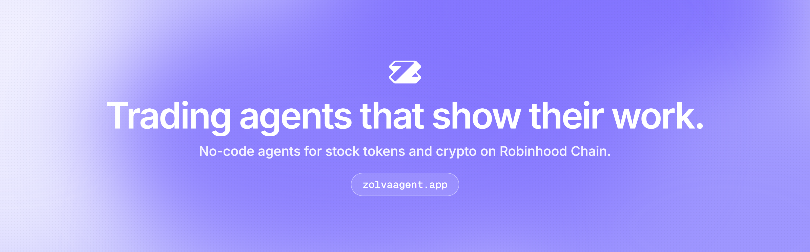
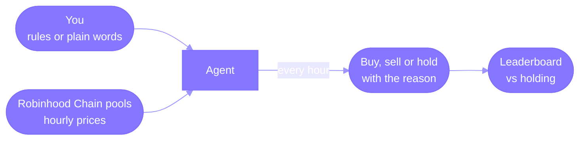

<p align="center">
  <a href="https://zolvaagent.app"></a>
</p>

<h1 align="center">Zolva</h1>

<p align="center"><strong>Trading agents that show their work.</strong><br/>
No-code trading agents for stock tokens and crypto on Robinhood Chain.</p>

<p align="center">
  <a href="https://zolvaagent.app">zolvaagent.app</a> ·
  <a href="https://zolvaagent.app/studio">Studio</a> ·
  <a href="https://zolvaagent.app/leaderboard">Leaderboard</a> ·
  <a href="https://zolvaagent.app/docs">Docs</a> ·
  <a href="https://zolvaagent.app/docs/public-api">API</a> ·
  <a href="https://zolvaagent.app/docs/mcp">MCP</a> ·
  <a href="https://x.com/zolva_agent">@zolva_agent</a>
</p>

---

Build an agent from presets, your own rules or a plain-words prompt, backtest it on the last 30 days, and launch
it. Every hour it reads prices straight from Robinhood Chain pools, decides to buy, sell or hold, and writes down
why. Each agent is measured against simply holding the same markets, and losses stay on the record.

20 US stocks and ETFs plus ETH and BTC. Paper trading is open to everyone; real money trading is in testing.



## Build on Zolva

Published agents, their decisions, markets and recent trades are open. No key needed.

```bash
# Public API
curl https://zolvaagent.app/api/public/v1/agents

# MCP server for Claude, Cursor and other assistants
claude mcp add --transport http zolva https://zolvaagent.app/mcp
```

## Repositories

| Repo | What it is |
|---|---|
| [zolva](https://github.com/zolvaagent/zolva) | The web app at zolvaagent.app: Studio, the hourly agent engine, backtests, prices from Robinhood Chain pools, the Public API and the MCP server |

## ZOLVA

The ZOLVA token has not launched yet. Holding it will unlock free AI reviews and higher limits, with nothing to
stake or lock: [zolvaagent.app/docs/token](https://zolvaagent.app/docs/token).

---

Paper trading uses virtual money; past results do not predict future results. Nothing here is investment advice.
Stock tokens are not offered to US persons. Zolva is built on Robinhood Chain and is not affiliated with or
endorsed by Robinhood.
